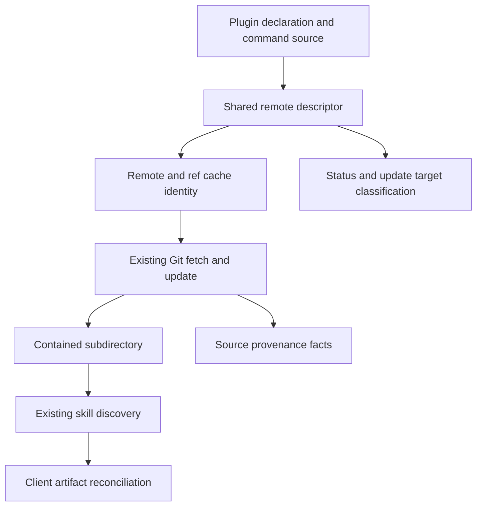
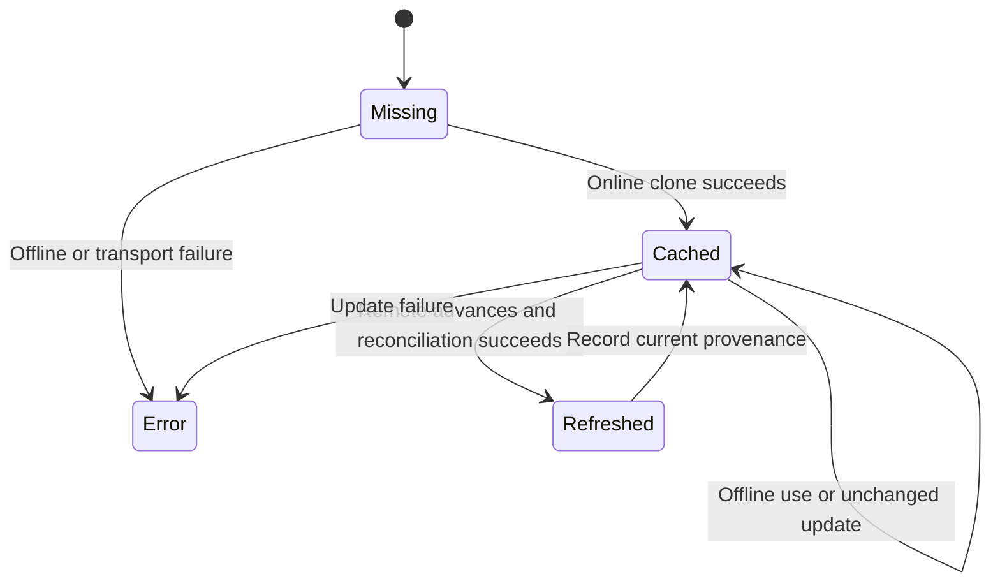

# Arbitrary Git Remote File Sources - Plan

## Goal Capsule

- **Objective:** Users install and refresh selected skills from their own Git servers without maintaining a separate checkout or marketplace manifest.
- **Means:** Extend ordinary remote plugin resolution and reuse Git transport and local discovery (KTD1–KTD4).
- **Authority:** [Upstream #553](https://github.com/allagentsdev/allagents/issues/553), PER-5 execution handoff, repository `AGENTS.md` and routed guides.
- **Execution:** Implement and verify locally, obtain independent review, publish a linked PR and report CI; board owns merge and release.
- **Stop conditions:** Evidence contradicts artifact ownership, product scope, or a required credential boundary; report the exact owner/action rather than claiming completion.

---

## Product Contract

### Summary

Ordinary file installations accept SSH URLs, SCP-style remotes and HTTPS remotes on arbitrary Git hosts, using the existing skill-selection and client reconciliation behavior.

### Problem Frame

AllAgents 1.20.0 routes non-GitHub remote sources through local-path validation and fails before Git transport. Users of Forgejo, GitLab and enterprise hosts currently need a separate local checkout even when Git authentication already works.

### Requirements

**Source and transport**

- R1. File-mode sources support SSH with custom ports, SCP-style Git URLs and non-GitHub HTTPS remotes.
- R2. Git retains configured SSH identities, agents and credential helpers; other hosts require no GitHub API or credentials in YAML.
- R3. Cloned content uses ordinary plugin/skill discovery, including standalone SKILL.md collections without marketplace manifests.

**Selection and identity**

- R4. Existing requested-ref and skill-selection contracts remain supported, with an explicit repository subdirectory mechanism.
- R5. Distinct hosts, ports, repository paths and requested refs remain distinct in physical cache identity and recorded provenance.

**Lifecycle and verification**

- R6. Install, refresh, status, offline use and uninstall preserve scope, ownership and output contracts; transport/authentication failures describe the remote failure rather than a missing local path.
- R7. Built install and refresh are verified using isolated local Git transport fixtures. Real private-host access is a separate validation and must never disclose credentials.

### Scope Boundaries

Pi/OMP native transport and Git marketplace registration remain separate capabilities. Workspace templates, standalone workspace files and profile import/export are not new arbitrary-host features in this delivery. Existing GitHub source spellings and cache layout remain compatible. No release, merge, repository settings or global Git configuration changes are authorized.

### Acceptance Examples

- AE1. An SSH custom-port source installed for project Codex/Pi file clients reaches Git, discovers a selected fixture skill and writes the client artifacts.
- AE2. A branch advances in the isolated remote; plugin update refreshes copied skills and the provenance SHA, while a second update reports unchanged behavior.
- AE3. Two remotes differing by host, port or path, and two refs differing by slash versus underscore, cannot reuse each other's cache or provenance.
- AE4. Offline installation succeeds with an existing cache and fails clearly without one; uninstall removes owned artifacts while retaining an unrelated user skill.

---

## Planning Contract

### Assumptions

The explicit source metadata mechanism is an encoded fragment such as `#ref=feature%2Fdemo&subdir=collections%2Fteam`. Generic remote path segments belong to the repository URL rather than implicitly denoting a checkout subpath. These are technical defaults within R4, not new product scope.

Real private-host credentials and a specific host fixture have not been granted for this run. Isolated transport proves delegation to Git and local lifecycle behavior; it does not prove access to a particular private service.

### Key Technical Decisions

- KTD1. **One remote descriptor, preserving GitHub behavior.** Extend `src/utils/plugin-path.ts` with a shared ordinary remote parser carrying clone URL, requested ref, subpath, display name and source kind. Wrap existing GitHub parsing rather than teaching `parseGitHubUrl` that every host is GitHub. Local paths remain local. SSH usernames are transport identity, never marketplace delimiters.
- KTD2. **Explicit fragment metadata.** Strip recognized encoded `ref` and `subdir` metadata before passing the exact remote to Git. Object-form `ref` supplies a requested ref when the source has none; an inline ref retains existing precedence. Reject empty or malformed metadata and checkout-escaping subdirectories. Keep source spelling in configuration. This avoids inventing a new YAML field or ambiguous `@ref` parsing on SSH URLs.
- KTD3. **Distinct generic remote cache keys.** Reuse `gitSourceKey` from `src/utils/git-source.ts` to derive a stable digest directory for generic remotes plus requested ref, with a readable repository label. Preserve legacy GitHub cache paths. Subdirectories share the physical clone for a remote/ref, while declaration/provenance keys retain subdirectory and requested ref. Do not strip a generic ref from provenance as GitHub's old `stripGitRef` convention does.
- KTD4. **Reuse Git lifecycle and discovery.** Pass the descriptor's clone URL to existing `cloneTo`, `pull`, remote revision checks and repository-health checks through `createGit`. Preserve its inherited environment and helper configuration. Extend fetch/update classification rather than adding a second transport engine. Logical plugin names come from the descriptor or discovered content, not an opaque digest directory.
- KTD5. **Install mode determines package status.** Source syntax alone cannot make an SSH source a native package. File declarations use remote cache/discovery status, while native installations keep their native adapter routing. Exact declaration targeting continues to distinguish the same source installed by different methods or scopes.

### High-Level Technical Design

Source grammar guidance: generic remote transport followed by optional encoded `ref` and `subdir` fragment parameters. The grammar changes only ordinary file plugin sources; local paths and native package source strings retain their own contracts.

### Behavior Trace and Caller Boundaries

`workspace-modify.ts` and `user-workspace.ts` perform declaration validation before sync, so changing fetch alone cannot make installation succeed. `sync.ts` validates sources, resolves discovery roots and writes provenance. `skills.ts` resolves sources for discovery. `plugin.ts` owns fetch caching plus check/apply update classification. `cli/skill-update.ts` and `core/skill-update.ts` derive physical update nodes and GitHub-only cache paths. `status.ts` currently classifies explicit SSH syntax as a package before checking file cache; it needs declaration mode context. `cli/commands/plugin-skills.ts` contains the ordinary skill commands, selection persistence and provenance paths.

GitHub-only calls in marketplace manifests, workspace templates, profile adapters and explicit GitHub fetch modules need not become generic remote features. Audit every parser/cache caller and distinguish those bounded contracts from ordinary plugin paths; migrate all ordinary callers.

---

## Implementation Units

### U1. Remote source metadata and cache identity

**Goal:** Give ordinary callers one unambiguous source description.

**Requirements:** R1, R4, R5. **Dependencies:** None.

**Files:** `src/utils/plugin-path.ts`, `src/utils/git-source.ts`, `src/models/workspace-config.ts`, `tests/unit/utils/plugin-path.test.ts`, `tests/unit/utils/git-source.test.ts`, `tests/unit/models/workspace-config.test.ts`.

**Approach:** Implement KTD1–KTD3, preserving existing GitHub spellings and local-path recognition. Integrate object refs through the effective-source helper so downstream string consumers cannot silently lose them. Centralize descriptor cache-path calculation and contained subdirectory resolution.

**Test scenarios:**

- Parse SSH custom port, SCP username, nested HTTPS group path and optional `.git` without rewriting the clone URL.
- Decode a slash-containing ref and subdirectory; object ref supplies the missing ref, while inline metadata wins.
- Local absolute/relative paths, Windows paths, marketplace declarations and legacy GitHub tree/inline-ref sources retain their classification.
- Reject malformed fragment metadata and absolute/traversing subdirectories; resolved symlink escape is rejected at checkout resolution.
- Covers AE3. Host/port/path/ref distinctions produce different cache and provenance identities; shared subdirectories use the same physical remote/ref clone.

**Verification:** Parser and model regression tests establish precedence and identity without networking.

### U2. Fetch and update arbitrary remotes

**Goal:** Clone and refresh ordinary remotes with the existing transport and update semantics.

**Requirements:** R1, R2, R5, R6. **Dependencies:** U1.

**Files:** `src/core/plugin.ts`, `tests/unit/core/plugin.test.ts`, `tests/unit/core/skill-update.test.ts`, an isolated Git transport test in `tests/unit/core/` if existing coverage cannot exercise the shared boundary.

**Approach:** Implement KTD4 in fetch, source classification, update check and update apply. Keep physical operation deduplication keyed by full remote/ref identity. Preserve detached-ref behavior and resolved SHA reporting. Do not rebuild GitHub URLs for generic remotes or call GitHub APIs.

**Test scenarios:**

- First fetch clones the exact generic remote at the requested branch or tag; repeated callers share that clone only for the same identity.
- Cached offline fetch uses the cache without transport; missing offline cache returns a clear failure.
- Covers AE2. Remote head advancement produces update facts and a repeat yields no change.
- A clone authentication failure and update transport failure retain existing success/failure semantics and useful remote diagnostics.
- User Git transport configuration reaches the real Git subprocess; no credential material is added to YAML.

**Verification:** Real isolated Git fixtures validate clone and remote refresh beyond dependency mocks.

### U3. Install, discovery, status and reconciliation integration

**Goal:** Make both project and user file-mode declarations consume the remote descriptor consistently.

**Requirements:** R1–R6. **Dependencies:** U1, U2.

**Files:** `src/core/workspace-modify.ts`, `src/core/user-workspace.ts`, `src/core/sync.ts`, `src/core/skills.ts`, `src/core/status.ts`, `src/cli/skill-update.ts`, `src/core/skill-update.ts`, `src/cli/commands/plugin.ts`, ordinary file-source paths in `src/cli/commands/plugin-skills.ts`, corresponding existing unit tests under `tests/unit/core/` and `tests/unit/cli/`.

**Approach:** Route remote validation through existing Git fetch/discovery; preserve selection filters, source names and exact configuration targeting. Implement KTD5. Update physical-node resolution and provenance collection using KTD3. Whole-plugin update and skill inventory currently collect raw sources: carry the effective declaration source, including object refs, through those boundaries. Uninstall continues through owned-artifact reconciliation; no remote transport is needed to remove a declaration.

**Test scenarios:**

- Covers AE1. Standalone selected SKILL.md content installs for Codex and Pi file clients, including a source subdirectory without a marketplace manifest.
- Project and user declarations use their existing destination scopes and can coexist.
- The same SSH source declared as file and native is classified according to install mode, retaining exact targeting.
- Generic remote status reads its cache and selected discovery root, and reflects a missing subdirectory instead of treating it as a package.
- Covers AE4. Offline sync uses cached selected content; uninstall leaves an unrelated user-owned skill intact.
- Per-plugin skills allowlist/blocklist and names survive refresh, with requested ref/subdirectory retained in provenance.

**Verification:** Focused install/status/update regressions and built lifecycle evidence agree on destinations and source facts.

### U4. Built transport acceptance and public documentation

**Goal:** Prove and explain the supported user path.

**Requirements:** R1–R7. **Dependencies:** U1–U3.

**Files:** new `tests/e2e/plugin-git-remotes.test.ts`, reused fixture helpers under `tests/e2e/`, `docs/src/content/docs/docs/reference/configuration.mdx`, relevant plugin/skill CLI documentation located during implementation.

**Approach:** Use local bare repositories and run-scoped Git configuration or a deterministic SSH transport wrapper to exercise the real built CLI with SSH custom ports, SCP and HTTPS URL rewrites. Advance a fixture branch and verify refreshed copied content. Document encoded source metadata, object ref precedence, Git-managed authentication, offline behavior and the native/file distinction.

**Test scenarios:**

- Built project install, branch advancement, plugin update, unchanged update, status, offline cached/missing installation and uninstall produce expected output and filesystem effects.
- Custom-port SSH, SCP and HTTPS sources route to the transport fixture; a missing remote reports transport failure rather than local-path lookup.
- Ref and host/port/path identity isolation is observable in resulting caches/provenance.
- Docs examples parse through the same source contract without exposing credentials.

**Verification:** Preserve commands, fixture description and observed outcomes in the PR/PER-5 evidence. Report real private-host validation as pending unless authorized access becomes available.

---

## Verification Contract

Use the declared Bun 1.4.0 from writable run scratch; keep Bun and npm temporary/cache paths writable. Focused `bun test` targets cover U1–U3 before broader integration checks. Run `bun run typecheck`, `bun run lint`, `bun run build` and `bun run test:e2e` after integration. The real built CLI must prove U4 in isolated HOME/project fixtures, with project-local Git identity/configuration and no changes to root/global Git settings.

Independent review follows implementation; eligible findings are resolved and affected tests rerun before final built E2E. Browser testing and TUI visual evidence do not apply if navigation/prompts are unchanged. Authentication fixture success is evidence that Git settings propagate, not evidence of successful private Forgejo/GitLab access.

---

## Definition of Done

U1 establishes stable parse/ref/cache behavior; U2 exercises the real Git boundary; U3 carries ordinary callers and ownership contracts; U4 supplies built lifecycle evidence and documentation. Remove abandoned approaches and temporary stale plans from the final shipping diff, preserving durable behavior in public docs and required evidence externally. The linked PR records checks, independent review, CI state and remaining private-host validation. Awaiting board merge is reported as awaiting merge; R7's real-host validation gap remains explicit.
